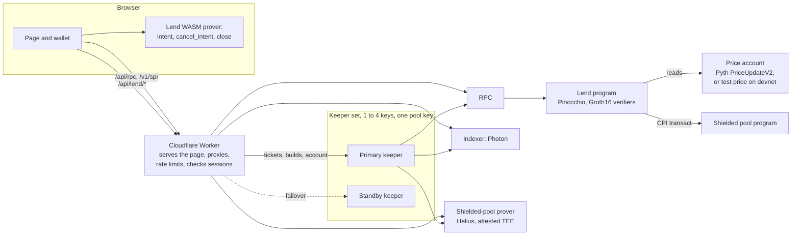

# Keeler

A lending pool with private amounts on Helius Privacy Rings (custom Xark circuits verified with
Groth16 in a Pinocchio program that moves notes through the shielded pool), with private swaps as
a second, smaller part.

[](https://github.com/0xinBeta/keeler/actions/workflows/ci.yml)


Recorded on devnet on 26 November 2026 with a new wallet, shown at three times speed (100 seconds
in real time): 100 tUSD supplied, a position opened with 0.5 tSOL, 58 tUSD borrowed, then the test
price is set to 132 and the keeper repays 11.046788 tUSD of the debt with 0.084020125 tSOL at
132.79. The keeper posts the test price of 150 again a few seconds later, which is why the vault
header still reads 150.

- Devnet lend program: [`CqfpHokrAewSvYhwN6sN8Uazt2UdBootqUj98hSi2ysL`](https://explorer.solana.com/address/CqfpHokrAewSvYhwN6sN8Uazt2UdBootqUj98hSi2ysL?cluster=devnet)
- Live page (devnet): https://keeler.xterminbeta.workers.dev

| | Public chain | Keeper | Other pool users | A liquidated owner |
| --- | --- | --- | --- | --- |
| Wallets that supply, borrow, repay, withdraw, are liquidated | seen | seen | seen | seen |
| Which pool or vault, which instruction, `now`, the price bound, an intent's expiry at fill or cancel | seen | seen | seen | seen |
| Borrow versus collateral withdrawal (`draw`) | hidden | seen | hidden | hidden |
| Full versus partial redeem or repay | hidden | seen | hidden | hidden |
| New position versus top-up (separate instructions) | seen | seen | seen | seen |
| That a wallet was liquidated, and that it was then past the threshold at a public price | seen | seen | seen | seen |
| Every amount: supply, collateral, debt, repay, liquidation size | hidden | seen | hidden | its own only |
| Health and liquidation price of a position | hidden | seen | hidden | its own only |
| Pool size and utilisation | coarse figures only (two significant figures, `/lend/pools`) | seen | estimable from the price indices at their own operations | as other users |
| The liquidator's other funds | hidden | seen | hidden | hidden, if the keeper liquidates from a note of exactly the repay (it does; not enforced) |
| The amount of any move between a public and a private balance, in either direction (shielding in, unshielding out) | seen | seen | seen | seen |

The Worker that serves the page also sees each wallet's account view in clear
(`docs/threat-model.md`).

**Status: devnet only, not for real funds.** The proving keys are test keys from a public seed, so
anyone can forge a proof; the circuits are unaudited and Xark is experimental; on devnet the
keeper posts the collateral price itself (a mainnet build cannot have that account and reads Pyth);
the keepers are a trusted set that sees every amount and can halt the pool. Before mainnet:
an external audit of the circuits, program, keeper and page; a multi-party key ceremony for the 11
lend circuits; the upgrade authority handed to a Squads multisig; and two always-on keeper hosts
(`docs/mainnet-runbook.md`; the internal review's findings are in `docs/audit-2026-11-25.md`).

Built with Claude Code.

## Architecture



- **Page** (`web/src/keeler/`). Derives the user's shielded keys from one wallet signature, asks
  a keeper for a signed ticket, proves and sends the intent itself, and proves `close` and
  `cancel_intent` itself. Before a wallet signs a keeper-built `redeem` or `draw` it checks the
  exact transaction (`lend-check.ts`): no lookup tables or durable nonce, only the lend
  instruction and compute-budget instructions, the keeper as fee payer, the owner as one read-only
  signer, `now`, expiry and price bound within limits, and every note the owner should receive
  at its slot, with payouts that open under the owner's key. The keeper set and pool viewing key
  are compiled into the site.
- **Worker** (`worker/src/index.ts`). The page's only network peer. Holds the Helius API key and
  the keeper HTTP key, proxies RPC, indexer and prover calls, checks the shape of every lend
  request and reply, verifies the session signatures before charging a global limit, and forwards
  to the first keeper in `LEND_KEEPERS`, the next one only when there is no keeper reply.
  `LEND_PAUSED` stops new supply, new positions and borrowing, never repayment or withdrawal.
- **Keeper set** (`cli/src/keeper.rs`, `cli/src/lend_chain.rs`, `docs/lend-keeper.md`). Up to four
  compiled keeper keys share one pool key, whose viewing key every reserve is encrypted to. A
  keeper holds the openings of the reserve, receipts and positions, issues tickets, fills only
  ticketed intents, builds owner-signed operations, watches positions against the price and
  liquidates from its own funds. One lane per pool: liquidations first, then repays and deposits,
  then supplies. Every build is recorded before it is sent; the chain decides which landed. A
  standby follows the others' transactions and takes over tickets and liquidations when the
  primary stops.
- **Lend program** (`lend/program/`). Pinocchio. Each instruction that spends a reserve checks a
  keeper signer, canonical PDAs, the pinned pool viewing key, a public `now` within 120 s of the
  clock, and for `draw` and `liquidate` the price bound against the price account. Deposits check
  a keeper signer and `now` and take no pool key; `intent`, `cancel_intent` and `close` are signed
  by the user and take neither. Each instruction then verifies the Groth16 proof against public
  inputs it computes itself, and signs the shielded-pool CPI for the pool and user PDAs.
- **Shielded pool program** (Privacy Rings, Default Ring). Holds every note; verifies its own
  transact proof. Its nullifiers stop double spends, and it lets the reserve's fixed address be
  created only once, so each pool has one reserve note.
- **Indexer** (Photon). Serves notes and proof data to the page and the keeper; the keeper reads
  its peers' outputs from it and checks each against the hash on chain.
- **Prover**. The shielded pool's transact proofs come from Helius' prover under the network's
  signed TEE policy (the local `zolana` prover on a local network). The lend circuits are never
  proved there: the browser proves its three, the keeper proves the rest natively.
- **Price account**. A mainnet build reads only the vault's pinned Pyth `PriceUpdateV2` account
  (receiver-owned, fully verified, pinned feed id, published within 90 s of the cluster clock). A
  `test-price` build, which devnet uses, also accepts a program-owned test price account that
  keepers write.

## Circuits

Eleven circuits, one verifying key each (`lend/program/src/circuits/`, `lend/sdk/src/proof.rs`,
`lend/lend-keys.CHECKSUM`).

| Circuit | Proved by | Spends | Creates | Rule it enforces |
| --- | --- | --- | --- | --- |
| `init_reserve` | keeper (admin co-signs) | nothing | the reserve | The reserve sits at the address derived from the mint, both price indices at 1e12, the curve's rate at zero utilisation |
| `intent` | browser | the maker's note | intent, change | The maker is the signer; the intent commits maker, purpose, target and expiry; amount non-zero; mint pinned |
| `cancel_intent` | browser | an intent | refund | Only the maker; all of it back to the maker; the public expiry is the intent's (the program allows it only after) |
| `supply` | keeper | reserve, intent | reserve, receipt | Accrue first; the whole intent into the reserve; the receipt to the maker for `floor(amount × 1e12 / supply price)` shares; at least 1 tUSD |
| `redeem` | keeper, owner signs | reserve, receipt | receipt, reserve, payout | Only the receipt's owner; burns `ceil(amount × 1e12 / supply price)` shares; paid from idle liquidity only; the payout to the owner |
| `deposit_open` | keeper | intent | position | A position for the maker with the intent's id, all of the collateral, no debt, at least the vault minimum |
| `deposit_add` | keeper | position, intent | position | Only into the maker's own position, the one the intent names |
| `draw` | keeper, owner signs | position, reserve | position, reserve, debt payout, collateral payout | Only the owner; afterwards debt at most the collateral factor (80%) of the collateral at the bound; utilisation at most 95%; vault minimums; both payouts always present |
| `repay` | keeper | position, reserve, intent | position, reserve, change | Only the maker's own position; debt shares removed by the repay rule, and a partial repay must remove at least one; the rest back to the maker |
| `liquidate` | keeper | position, reserve, the keeper's note | position, reserve, change, collateral payout | Past the threshold (85%) at the bound; `0 < x <= debt`; at least one debt share removed; payout `floor((x + 1% of x) × 1e12 / bound)` capped at the collateral; not left healthier than the threshold unless above the max limit (90%) |
| `close` | browser | a position with no debt | payout | Only the owner; zero debt shares; all the collateral back |

Every circuit that spends a reserve accrues it to the public `now` first, rebuilds its address from
the mint, and takes the keeper's fresh salt. Every keeper-proved circuit that serves a user seeds
its output blindings from a note that user holds (the intent, receipt or position), so the user
can recompute its own outputs. The maths is
`core/src/lend.rs`, with shared vectors (`web/tests/fixtures/lend-vectors.json`) that the Rust
reference and the page's TypeScript twin pass; the circuits, run natively, pass the vectors of
the functions they implement (the tests in `circuits/math.rs` and `circuits/vault.rs`). Why these
shapes: `docs/design-decisions.md`.

## Measured

Every figure below comes from a command in [`lend/MEASUREMENTS.md`](lend/MEASUREMENTS.md), run once
on an Apple M4 (10 cores, 16 GB) on 2026-11-25 while the local validator, indexer and prover of the
same test were running. Transaction size is the v1 wire size against the 4,096-byte v1 limit
(`solana_message::v1::MAX_TRANSACTION_SIZE`). Every lend proof is 128 bytes as sent.

| Instruction | Constraints | Native proving | Compute units | v1 tx bytes (of 4,096) | Ix data bytes | Accounts (ix / tx) |
| --- | --- | --- | --- | --- | --- | --- |
| `init_reserve` | 20,569 | 0.90 s | 249,865 | 1,236 | 789 | 9 / 8 |
| `intent` | 14,097 | 0.91, 0.92 s | 245,202, 245,350 | 1,244 | 893 | 9 / 7 |
| `cancel_intent` | 7,179 | 0.77 s | 244,561 | 977 | 627 | 8 / 7 |
| `supply` | 33,652 | 1.93 to 2.13 s | 267,174 to 268,913 | 1,553 | 1,137 | 10 / 9 |
| `redeem` (partial / full) | 35,302 | 2.08 / 2.09 s | 269,435 / 272,070 | 1,767 | 1,254 | 11 / 10 |
| `deposit_open` | 14,546 | 0.94, 0.95 s | 245,220 | 1,148 | 798 | 8 / 7 |
| `deposit_add` | 23,859 | 1.26 s | 249,409 | 1,214 | 831 | 9 / 8 |
| `draw` (borrow) | 45,657 | 2.39 to 2.43 s | 276,718 to 280,570 | 1,949 | 1,403 | 12 / 11 |
| `repay` (partial / full) | 46,929 | 2.48 / 2.51 s | 274,617 / 276,943 | 1,760 | 1,311 | 11 / 10 |
| `liquidate` | 48,878 | 2.56 to 3.35 s | 277,177 to 278,637 | 1,889 | 1,406 | 13 / 11 |
| `close` | 13,510 | 0.84 to 1.06 s | 246,335 to 246,339 | 977 | 627 | 8 / 7 |

Not measured: proving time in the browser (`intent`, `cancel_intent` and `close` are the three the
page proves), a `draw` that only withdraws collateral, and the shielded pool's own proof on its own.

The toolkit spike, on prototype circuits that are not the shipped ones (source:
`docs/notes-for-xark-builders.md`, from `lend/scripts/run-spike.sh`):

| Spike instruction | CU | v1 tx bytes (of 4,096) | ix data bytes | Accounts |
| --- | --- | --- | --- | --- |
| init (address reservation) | 242,298 | 1,139 | 789 | 8 |
| accrue (2 in) | 250,577 | 1,206 | 822 | 10 |
| fund (1 in, 3 out) | 246,813 | 1,461 | 1,110 | 9 |
| touch, dummy top-up (3 in, 4 out) | 264,753 | 1,725 | 1,146 | 13 |
| touch, real top-up (4 in, 4 out) | 269,015 | 2,106 | 1,493 | 15 |

| Spike circuit | Constraints | Native proof (Apple M-series, release) |
| --- | --- | --- |
| `SpikeInit` | 16,731 | 0.83 s |
| `SpikeAccrue` (accrue, shares, refresh) | 30,431 | 1.47 s |
| `SpikeFund` | 9,847 | 1.0 s |
| `SpikeTouch` (accrue, repay, health, refresh) | 45,174 | 2.8 s |

Shielded-pool proofs from the local prover took 0.13 to 0.5 s for 1 to 2 inputs and 0.7 to 2.2 s
for 3 to 4. Three of the five spike transactions are over the 1,232-byte legacy packet, so Keeler
sends v1 transactions.

## Build and run

Needs macOS on Apple silicon (every mainnet secret is read from the macOS Keychain with
`security`; a devnet config may read its secrets from the environment instead), git, curl, Python 3.11 or newer, rustup, the Solana/Agave CLI (`cargo build-sbf`),
`wasm-pack` (the circuit compiler builds the browser packages with it), Node and pnpm. The setup
scripts and the gating tests also run on Linux x86-64 (CI); the local-network and end-to-end tests
have been run on macOS only.

Pinned in the repository: Rust 1.98.1 (`rust-toolchain.toml`, `lend/rust-toolchain.toml`);
`helius-labs/privacy-ring-examples` at `9e5d69ade7e0c107a2929306d3b758a8969e1089` (`scripts/setup.sh`)
and SBF platform tools v1.54 (`scripts/setup.sh`, `scripts/setup-lend.sh`); `xark` 0.3.1, the `spr-*` crates 0.10.0
(`spr-hasher` 0.8.0), built with the `zolana` CLI `cli-v0.10.0` (`lend/Cargo.toml`);
`@heliuslabs/spr` 0.9.0-alpha (`web/package.json`); Node 26.13.1 LTS (`.node-version`); pnpm 10.28.2
(`packageManager` in `web/package.json` and `worker/package.json`); Agave 4.1.2 and `wasm-pack`
0.15.1, the versions CI installs (`AGAVE_VERSION`, `WASM_PACK_VERSION` in
`.github/workflows/ci.yml`). Outside the checkout, `scripts/setup.sh` downloads the Zolana prover,
Photon and surfpool into `~/.config/zolana/cache`, and the provers keep their keys in
`~/.config/zolana/proving-keys`.

```sh
scripts/setup.sh        # the pinned swap example into .tools/, .tools/env; idempotent, slow the first time
source .tools/env
scripts/setup-lend.sh   # lend circuits and test keys (checked against lend/lend-keys.CHECKSUM), WASM, .so
```

Tests:

```sh
cargo test -p keeler-core
cargo test -p keeler --lib --test fixtures --test deploy_mainnet_refusals
cd lend
cargo test --release -p keeler-lend --features build-circuits --lib   # maths and the shared vectors
cargo test -p keeler-lend --test program --test earn --test vault    # Mollusk, on lend/target/deploy/keeler_lend.so
cargo test --release -p keeler-lend-sdk                               # builders, compiled-circuit refusals
scripts/run-chain-test.sh                                             # local network, port offset 2100
cd ..
scripts/run-lend-e2e.sh                                               # the keeper end to end, two keepers, port offset 2500
(cd web && pnpm install && pnpm test)
(cd worker && pnpm install && pnpm test)
scripts/run-swap-e2e.sh                                               # swaps end to end, port offset 2600
```

The page against a real local keeper: `scripts/lend-web-stack.sh start` (local network, keeper,
Worker), then `cd web && pnpm exec playwright install chromium && pnpm e2e:lend`; the same page against
its mock client, with no network: `pnpm e2e:mock`. Local networks use a port offset and stop what they start.
The scripts read the tool paths from the main checkout's `.tools/env`; each checkout builds its own
`target/` (several GB).

Continuous integration (`.github/workflows/ci.yml`, on every push and on pull requests to `main`) runs on Linux:
`cargo fmt --check`, `cargo clippy -D warnings`, `scripts/setup.sh` and `scripts/setup-lend.sh`
(so the lend keys checksum is checked), the `keeler-core`, `keeler` (lib, fixtures, deploy refusals),
circuit and lend SDK native tests, and the web and Worker type checks and unit tests. It does not
run the Mollusk tests, the local-network tests, the two end-to-end tests or the mock browser suite:
those are `.github/workflows/slow.yml`, run by hand, which gates nothing and has to be dispatched once after it reaches `main`. Nothing in CI runs the page
against a real local keeper, reaches devnet or mainnet, or uses a secret.

Devnet and mainnet deploys: `docs/lend-deploy.md` (`scripts/deploy-lend-devnet.sh`) and
`docs/mainnet-runbook.md` (`scripts/deploy-mainnet.sh`, which refuses test keys, the test price, a
dirty tree and a single-key upgrade authority).

## Repository layout

| Path | What |
| --- | --- |
| `lend/program/` | The lend program: instructions, circuits, generated verifiers, build parameters |
| `lend/sdk/` | Rust builders and provers for every instruction, chain and refusal tests |
| `lend/spike/` | The toolkit spike (prototype circuits, local network only) |
| `core/` | Shared maths: `lend.rs` (the reference for circuits, keeper and page), `rfq.rs`, `price.rs` |
| `cli/` | The `keeler` binary: keeper, swap dealer and trader, deploy tool |
| `web/` | The page: wallet, lend and swap clients, the signing check, tests |
| `worker/` | The Cloudflare Worker |
| `scripts/` | Setup, local stacks, deploys, end-to-end runners |
| `patches/swap.patch` | The `wasm` feature added to the swap example |
| `docs/` | Design, threat model, audit, runbooks, API |

## Documents

- `docs/threat-model.md`: who can do what, what enforces it, and a proposal for running the
  keeper in an enclave (Phala dstack, with AWS Nitro Enclaves as the alternative).
- `docs/design-decisions.md`: the reasons behind the reserve note, fixed outputs, the keeper
  signature, the price bound, keeper-built transactions and liquidation sizing.
- `docs/notes-for-xark-builders.md`: Xark pitfalls hit here and the spike's measurements.
- `docs/audit-2026-11-25.md`: the internal security review and its decisions.
- `docs/plan-lend.md`: the lending design, the keeper set and the pool key.
- `docs/lend-keeper.md`, `docs/lend-api.md`: running the keeper; the page-keeper contract.
- `docs/mainnet-runbook.md`, `docs/lend-deploy.md`: deploys.

## Known limits

- Test proving keys on devnet: any proof can be forged, so the circuit rules do not hold there.
- The keepers see every amount, order every operation, and can halt the pool; with every pool-key
  holder gone, Earn deposits and indebted positions cannot move (intents refund after expiry and
  debt-free positions close without a keeper).
- On devnet a keeper sets the price, so it can trigger any liquidation.
- Wallets are public on every operation until custom rings are live.
- One operation at a time per pool.
- An intent's expiry has no upper bound in the circuit; the page uses the ticket's.
- The liquidated owner can derive the blinding of the liquidator's change note; the keeper
  liquidates from a note of exactly the repay so that change is zero.
- The accepted review findings K-2 and W-3, and the rest of `docs/threat-model.md`.

## Swaps

The second part: a private quote router. A trader asks several dealers for a quote, drops quotes
far from a reference price, and settles the best one through the Helius Privacy Rings swap example
program (`helius-labs/privacy-ring-examples`, `swap/xark`), built from `.tools/` by
`scripts/setup.sh` with its own test keys. Amounts and the price stay inside shielded notes and
order terms encrypted to the trader and the chosen dealer; both wallets, both asset ids, and that
a swap was made and later taken or cancelled are public; every dealer asked learns the pair, the
size and the trader's public key.

<details>
<summary>Swap commands and configuration</summary>

All times are chain time. On the local network chain time runs at about 0.87 of wall time, so a
30 s quote lasts about 35 s on the wall clock.

- `keeler swap <config> <sell_mint> <buy_mint> <amount>`: checks that one note covers `amount`,
  asks every dealer (2 s timeout each), keeps quotes within `band_bps` of the reference price whose
  time to live is within `[min_ttl_secs, max_ttl_secs]`, locks the largest, and waits on the
  order's nullifier. It prints `settled: received <n>`, or after expiry cancels and prints
  `not settled before expiry: refunded`.
- `keeler dealer <config>`: registers, serves quotes on `listen` (loopback only) at the reference
  price less `spread_bps`, and settles only orders that exactly match a quote it gave, while
  `now + settle_margin_secs` is before the expiry and the quoted amount is at most the fair amount
  at the current price plus `settle_tolerance_bps`. It signs every quote and keeps its quotes in a
  state file across restarts. The trader drops a quote not signed by the dealer's `pubkey`.
- `keeler refund <config>` (trader config): cancels every unspent order of this trader whose
  expiry has passed, in the assets the config lists.
- `scripts/dev.sh [offset] [port]`: the whole swap web app on a local network, the real Worker
  under `wrangler dev`; `cd web && pnpm e2e` drives it. `scripts/localnet.sh start|stop <offset>`
  starts just the stack.
- `scripts/deploy-devnet.sh`, `scripts/run-dealer.sh` (the dealer, and the keeper when its config
  has a `lend` section, behind a tunnel), `scripts/set-upgrade-authority.sh`.

Amounts are base units; mints are base58; SOL is `11111111111111111111111111111111`. Run with
`source .tools/env` so the binary finds the proving keys (`SWAP_KEYS_DIR`).

`network.prover` is `"local"` or `{"helius": {"keychain": "<name>"}}` (Helius' attested prover,
the API key read from that Keychain item, or `{"env": "<NAME>"}`). `key` is
`{"file": "<keypair.json>"}` for local test keys, `{"keychain": "<name>"}`, or `{"env": "<NAME>"}`
(the environment variable holds what the Keychain item would; refused on mainnet). A price is fixed (`{"price": 15, "expo": -2}` is 0.15 USD) or
`{"pyth": {"account", "feed_id"}}` with a `pyth` section (`max_age_secs`, `max_conf_bps`), read on
chain and checked for owner (`rec5EKMGg6MxZYaMdyBfgwp4d5rB9T1VQH5pJv5LtFJ`), full verification,
feed id, age, sign and confidence.

Trader:

```json
{
  "network": {"rpc_url": "http://127.0.0.1:8899", "indexer_url": "http://127.0.0.1:8784", "prover": "local"},
  "key": {"keychain": "keeler-trader"},
  "assets": [
    {"mint": "<spl mint>", "price": {"price": 2, "expo": 0}},
    {"mint": "11111111111111111111111111111111", "price": {"price": 100, "expo": 0}}
  ],
  "dealers": [{"address": "127.0.0.1:47001", "pubkey": "<dealer Solana public key>"}],
  "band_bps": 50,
  "min_ttl_secs": 10,
  "max_ttl_secs": 120
}
```

Dealer:

```json
{
  "network": {"rpc_url": "http://127.0.0.1:8899", "indexer_url": "http://127.0.0.1:8784", "prover": "local"},
  "key": {"file": "dealer.json"},
  "assets": [
    {"mint": "<spl mint>", "price": {"price": 2, "expo": 0}},
    {"mint": "11111111111111111111111111111111", "price": {"price": 100, "expo": 0}}
  ],
  "listen": "127.0.0.1:47001",
  "spread_bps": 10,
  "quote_ttl_secs": 30,
  "settle_margin_secs": 5,
  "program_id": "F4hjig5RJbXW6vrgYaMcuWzR55kZF6tbKyf8c36nrtvU"
}
```

Optional dealer fields: `http` (`listen`, `key`, `allow_remote`) for the HTTP API; `poll_secs`; `faucet`;
`state_file` (mode 0600); `pause_file`; `settle_tolerance_bps`; `limits` per mint
(`max_sell_amount`, `hourly_sell_cap`); `pubkey`; `auto_pause_after`; `min_fee_lamports`.

Dealer HTTP (loopback only unless `http.allow_remote`, refused on mainnet; `x-keeler-key` on every
request, 4 KiB body cap):
`POST /quote` `{"sell_mint","buy_mint","sell_amount","trader"}` -> `{"quote":{"buy_amount","expiry","signature"}}`;
`POST /faucet` `{"wallet"}`; `GET /health`. Quote signatures are Ed25519 by the dealer's key over
`"keeler-quote-v2"`, a network byte, then program, mints, trader, amounts and expiry
(`core/src/rfq.rs`, vector in `web/tests/fixtures/quote-sig.json`).

Swap limits: the example's test keys make every devnet order takeable by anyone; the upstream
prover listens on every interface; the quote protocol is plain text on loopback; a winning dealer
that never settles locks the trader's funds until expiry; quotes reserve nothing; dealer discovery
rescans the order history on every poll.

</details>

## Licence and credits

Apache-2.0 (`LICENSE`). The swap side runs Helius' `privacy-ring-examples` swap program, fetched
at a pinned commit and patched (`patches/swap.patch`), not copied; five test and SDK helper files
derive from that repository (`NOTICE`). Built on Helius Privacy Rings (`spr-*`,
`@heliuslabs/spr`), Blueshift's Xark, and Pinocchio.
